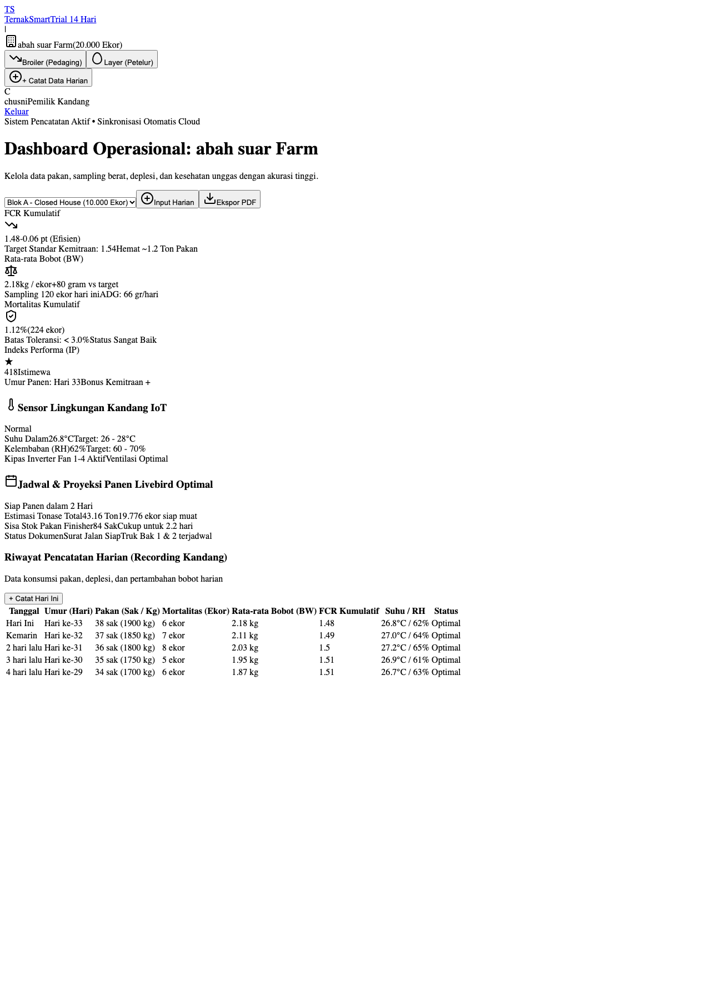

# Be-Ternak (Moklet 2.0) — Platform Manajemen Peternakan Unggas Presisi

Platform software manajemen peternakan unggas terpadu khusus untuk peternak **KUB Pedaging** dan **KUB Petelur**. Dirancang untuk kontrol presisi *Feed Conversion Ratio* (FCR), *Hen-Day Production* (HDP), stok pakan, dan deteksi anomali kematian unggas sesuai standar agribisnis modern.



---

## 🌟 Fitur Utama

### 1. 2 Modul Utama Operasional
- **Modul KUB Pedaging (Closed House & Semi-Modern)**:
  - Monitoring FCR Kumulatif terhadap target kemitraan (1.48 vs standar 1.54).
  - Sampling bobot harian (BW) dan pertambahan bobot harian (*Average Daily Gain* / ADG).
  - **Integrasi KMS (Kartu Menuju Sukses) Resmi BRMP Jawa Timur (Unit Perbibitan Ayam KUB)**:
    - Kurva acuan bobot baik mingguan dari Minggu 1 (40 gr) hingga Minggu 20 (1.940 gr).
    - Grafik SVG interaktif standar vs realisasi angkatan pemeliharaan (Angkatan I s/d IV).
    - Tabel matriks 20 minggu penimbangan dengan evaluasi deviasi capaian bobot.
    - Modal input penimbangan mingguan dan pratinjau scan kartu fisik resmi BRMP Jatim.
  - Deplesi mortalitas harian dan rasio efisiensi tonase panen.
  - Telemetri sensor IoT kandang: Suhu (°C), Kelembaban (*Relative Humidity* / RH), Gas Amonia (ppm), dan status aktivasi *Inverter Fan*.
  - Proyeksi jadwal muat panen livebird dan estimasi kecukupan stok pakan finisher.

- **Modul KUB Petelur (Baterai Semi-Modern)**:
  - Monitoring persentase *Hen-Day Production* (HDP) puncak (94.6%).
  - Total panen butir harian dan konversi rak telur standar (*Egg Tray* 30 butir).
  - Klasifikasi mutu telur terperinci: Telur Grade A Utuh, Retak / Kerabang Tipis, dan Telur Kotor.
  - Inventaris stok bahan pakan (Konsentrat 35%, Jagung Pipil KA 13.8%, Dedak Halus) dan proyeksi afkir unggas.

### 2. Antarmuka Lapangan & Mobile-First Experience
- **Sticky Mobile Bottom Quick Bar**: Akses langsung ke modul KUB Pedaging, modul KUB Petelur, dan tombol sentral **`+ Catat`**.
- **Formulir Input Harian Cepat**: Native `<dialog>` dengan transisi *modal pop-in*, kalkulasi live otomatis (ADG & HDP/Tray), serta segment switcher modul.
- **Tabel Responsif Lapangan**: Bantuan indikator geser horizontal dengan font mono presisi tinggi.
- **Standar Desain Anti-Slop**: Kontras tinggi untuk penggunaan luar ruangan (*outdoor readability* WCAG AA 4.5:1 untuk teks dan 7:1 untuk metrik utama), radius sudut konsisten 8px, dan nol emoji generik (ikon SVG murni).

### 3. Ekspor & Manajemen Dokumen
- **Ekspor CSV**: Unduh seluruh riwayat rekaman harian dalam format tabular spreadsheet.
- **Cetak Laporan (PDF)**: Format dokumen standar cetak untuk laporan kemitraan inti-plasma dan pengawas PPL.

---

## 🚀 Panduan Menjalankan Proyek

Platform ini dibangun menggunakan teknologi web standar tanpa ketergantungan runtime yang rumit (*zero dependency*):
- **HTML5 Semantic**
- **Modern CSS (Custom Properties / Design Tokens)**
- **Vanilla JavaScript (ES6 Modules & Reactive DOM)**

### Cara Menjalankan Lokal

1. **Clone repositori ini**:
   ```bash
   git clone https://github.com/chusni-moklet/brmp-ternak.git
   cd brmp-ternak
   ```

2. **Jalankan local server** (pilih salah satu opsi):

   - **Menggunakan Python 3**:
     ```bash
     python3 -m http.server 8085
     ```
     Buka di browser: `http://localhost:8085`

   - **Menggunakan Node.js `npx serve`**:
     ```bash
     npx serve .
     ```

   - **Atau langsung buka file `index.html`** di browser modern Anda.

---

## 📁 Struktur Direktori

```
brmp-ternak/
├── assets/
│   ├── broiler.jpg          # Foto dokumentasi ayam broiler closed house
│   ├── hero-farm.jpg        # Foto interior kandang modern resolusi tinggi
│   └── layer-eggs.jpg       # Foto produksi telur grade A segar
├── app.js                   # Logika interaktif aplikasi & state manajemen
├── data.js                  # Model data standar breed Cobb 500 & Lohmann Brown
├── index.html               # Struktur landing page & operational dashboard
├── style.css                # Sistem desain & aturan responsif mobile-first
├── dashboard_broiler.png    # Preview dashboard modul broiler
├── dashboard_layer.png      # Preview dashboard modul petelur
└── README.md                # Dokumentasi proyek
```

---

## 📊 Standar Genetika & Parameter Teknis

| Parameter | Modul KUB Pedaging | Modul KUB Petelur |
| :--- | :--- | :--- |
| **Metrik Utama** | FCR (Kumulatif: 1.48) | HDP (Puncak: 94.6%) |
| **Satuan Bobot / Produksi** | BW: 2.18 kg/ekor | 18.920 Butir (630.6 Tray) |
| **Standar Kematian** | < 0.08% / hari (Normal) | < 0.05% / hari (Normal) |
| **Suhu Ideal** | 26.5°C – 27.5°C | 24.0°C – 26.0°C |
| **Ambang Batas Amonia** | < 20 ppm | < 15 ppm |

---

## 📄 Lisensi & Hak Cipta

© 2026 **Be-Ternak / Moklet Agrotech** — Dibuat untuk ekosistem peternak Indonesia di Pasuruan, Blitar, dan sekitarnya.
Hak Cipta Dilindungi Undang-Undang.
